<div align="center">

# Vennd

**En dagbok over folka du kjenner.**

Skriv ned et treff på under et halvt minutt. Neste gang du skal møte noen, ser du hva du lurte på sist.

Next.js 16 · React 19 · TypeScript · Prisma 7 · Postgres · Claude API · Vercel

</div>

<picture>
  <source media="(prefers-color-scheme: dark)" srcset="docs/screenshots/dark/naerhet-profil.png">
  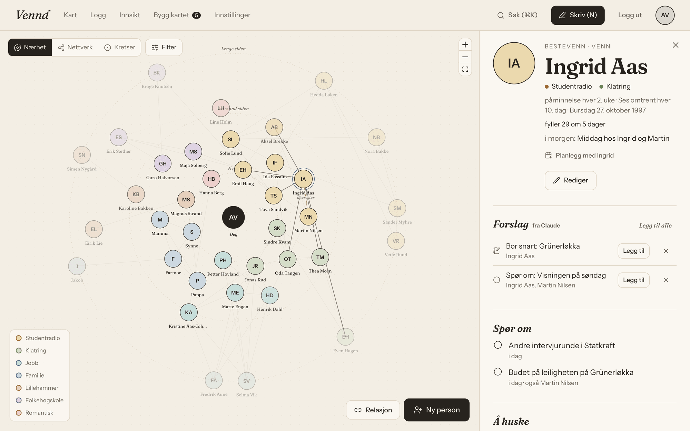
</picture>

> Alle personer på bildene er oppdiktet (`scripts/seed-showcase.mts`).

## Hvorfor

Jeg glemmer ting. At Ingrid hadde intervju på torsdag, eller at det er et halvt år
siden jeg snakket med en barndomsvenn. Vennd er laget for å hjelpe med akkurat det:

1. **Skriv ned** hva som skjedde, med vanlige ord. Navnene du skriver, blir koblet
   til personene.
2. **Husk** det som er verdt å huske: ting du vil spørre om, fakta og planer.
3. **Følg opp.** Før neste treff ser du hva som står åpent, og kartet viser hvem
   du ikke har sett på en stund.

## Kartet

Kartet viser de samme folka på tre måter. Det er tegnet med `@xyflow/react`, og
plasseringen regnes ut av vanlige funksjoner som har egne tester.

<p align="center">
  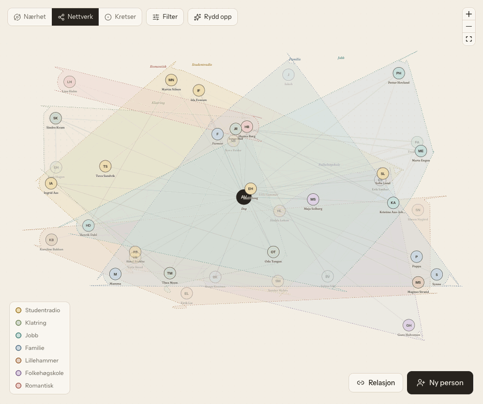
</p>

| Nærhet | Nettverk | Kretser |
|---|---|---|
| Jo lenger siden du så noen, jo lenger ut står de. Hvor ofte du vil se dem, er med i regnestykket. | Her plasserer du folk selv, og hvert miljø får et omriss. «Rydd opp» samler miljøene rundt deg, og miljøer med mange felles kjente havner ved siden av hverandre. | Hvert miljø får sin bit av sirkelen. Strekene mellom miljøene samles i bunter, så det blir lettere å se hvem som kjenner hvem. |

<table>
  <tr>
    <td width="50%">
      <picture>
        <source media="(prefers-color-scheme: dark)" srcset="docs/screenshots/dark/nettverk-for.png">
        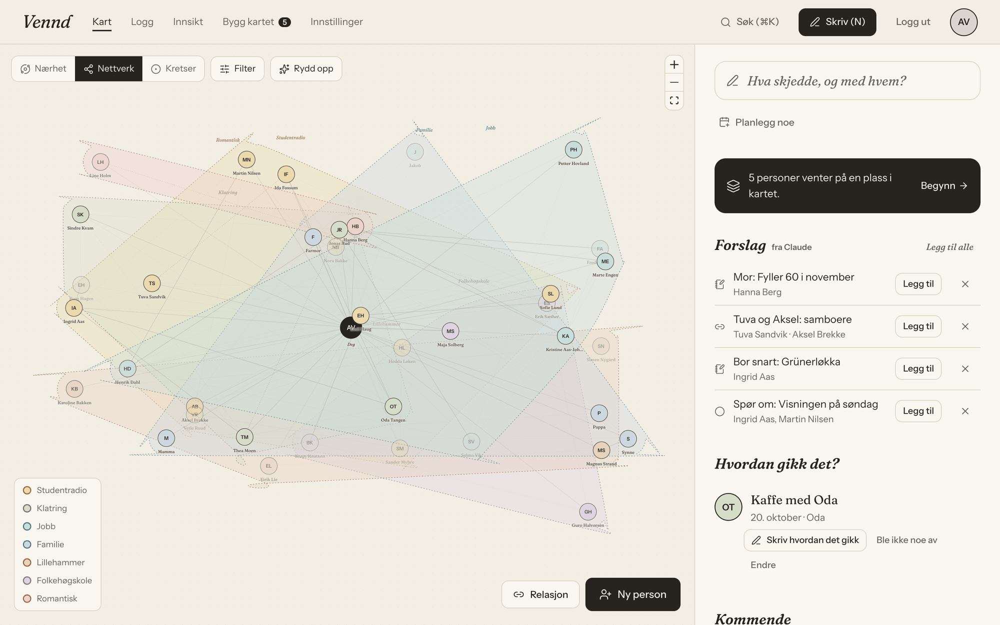
      </picture>
      <p align="center"><sub>Før «Rydd opp»</sub></p>
    </td>
    <td width="50%">
      <picture>
        <source media="(prefers-color-scheme: dark)" srcset="docs/screenshots/dark/nettverk.png">
        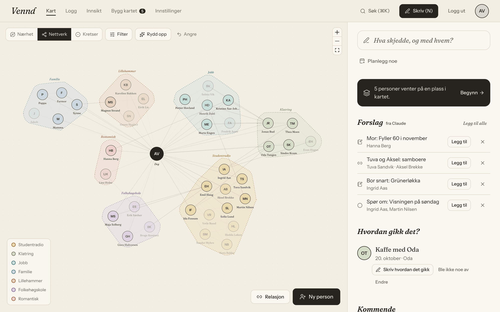
      </picture>
      <p align="center"><sub>Etter</sub></p>
    </td>
  </tr>
</table>

<picture>
  <source media="(prefers-color-scheme: dark)" srcset="docs/screenshots/dark/kretser.png">
  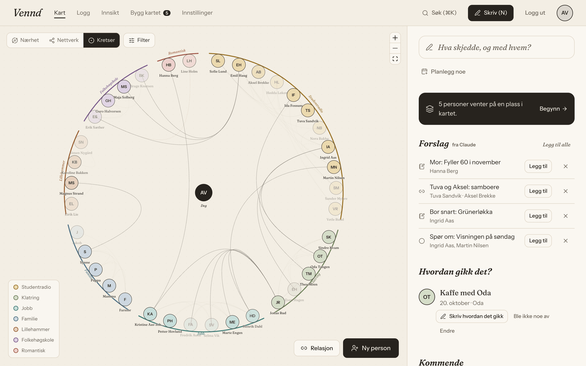
</picture>

## Skrive og følge opp

Trykk N, og skriv. Appen kjenner igjen navnene mens du skriver («middag hos Ingrid
og Martin») og viser hva du hadde tenkt å spørre dem om, så du kan krysse av det.
Den gjetter heller for lite enn for mye: har to personer samme fornavn, spør den
hvem du mener.

<picture>
  <source media="(prefers-color-scheme: dark)" srcset="docs/screenshots/dark/skriv.png">
  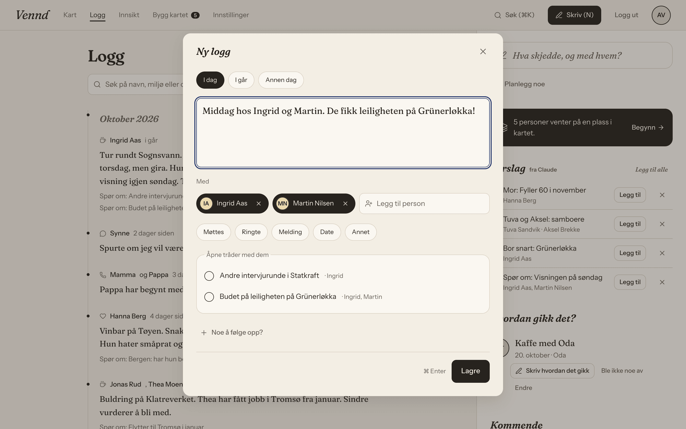
</picture>

<table>
  <tr>
    <td width="50%">
      <picture>
        <source media="(prefers-color-scheme: dark)" srcset="docs/screenshots/dark/logg.png">
        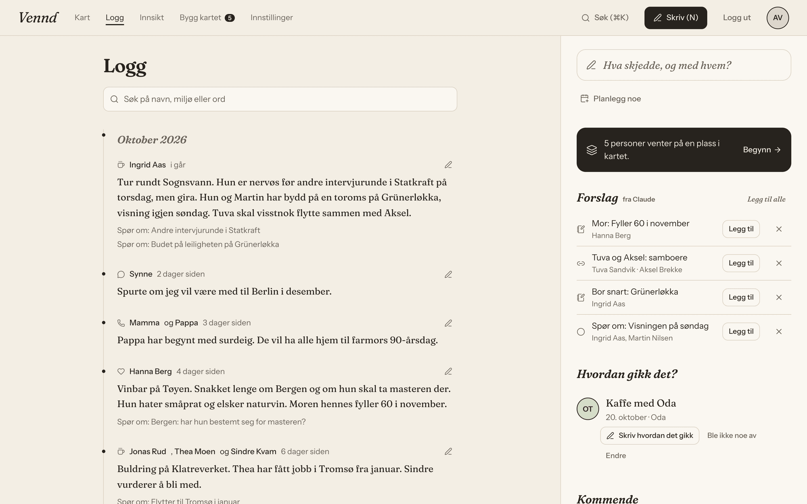
      </picture>
      <p align="center"><sub>Loggen, med søk og månedskapitler</sub></p>
    </td>
    <td width="50%">
      <picture>
        <source media="(prefers-color-scheme: dark)" srcset="docs/screenshots/dark/sok.png">
        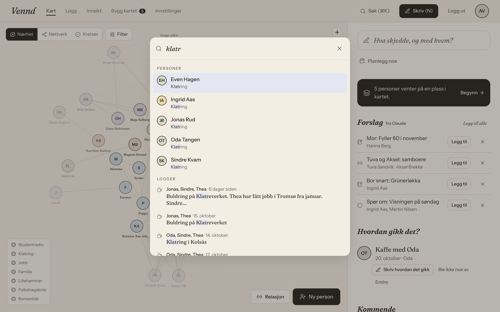
      </picture>
      <p align="center"><sub>Søk (⌘K) i personer, miljøer og logger</sub></p>
    </td>
  </tr>
  <tr>
    <td width="50%">
      <picture>
        <source media="(prefers-color-scheme: dark)" srcset="docs/screenshots/dark/innsikt.png">
        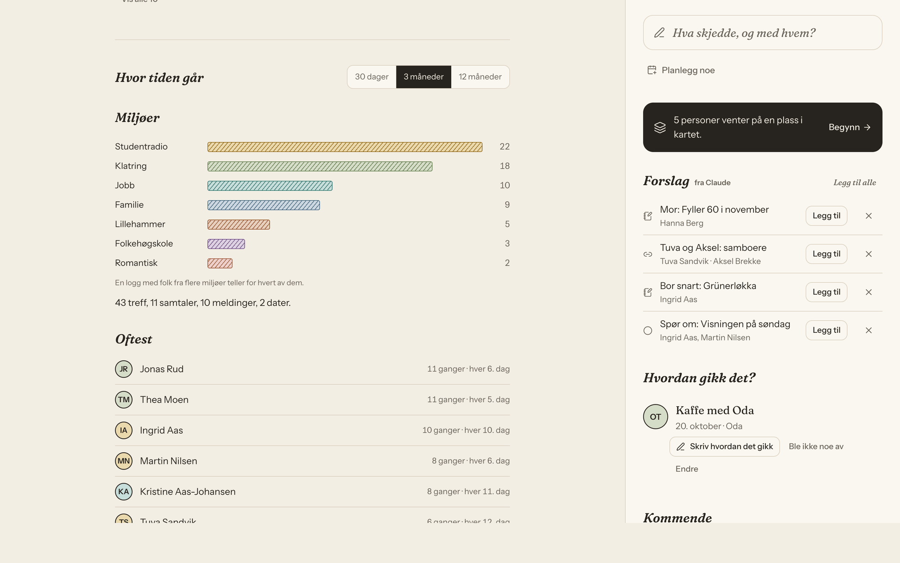
      </picture>
      <p align="center"><sub>Innsikt: hvor tiden går, og hvem du ser mest</sub></p>
    </td>
    <td width="50%">
      <picture>
        <source media="(prefers-color-scheme: dark)" srcset="docs/screenshots/dark/kort.png">
        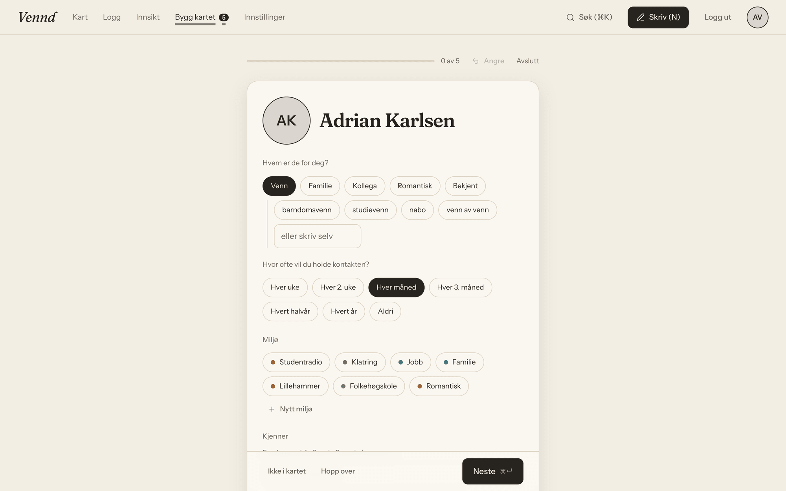
      </picture>
      <p align="center"><sub>Bygg kartet: én og én person</sub></p>
    </td>
  </tr>
</table>

## Claude

Claude leser det du skriver og foreslår ting du ellers måtte ha lagt inn selv.
Ingenting blir lagret før du har sagt ja.

- **Etter en logg** kommer forslag til ting å følge opp, fakta og hvem som kjenner
  hvem («Tuva og Aksel: samboere»). Det er ett kall per logg, og det kjører etter
  at loggen er lagret, så du slipper å vente.
- **«Fortell om»** lar deg skrive litt fritt om en person. Claude plukker ut
  bursdag, miljø, hvem de kjenner og så videre.
- **Forslag til forbindelser** sender en kort oppsummering av hele nettverket.
  En gjeng der alle kjenner alle, blir én linje, så 71 personer og 813 koblinger
  blir rundt 700 tokens. Svaret er noen få samlede forslag («Redaksjonen»), ikke
  hundrevis av enkeltpar.

<picture>
  <source media="(prefers-color-scheme: dark)" srcset="docs/screenshots/dark/forbindelser.png">
  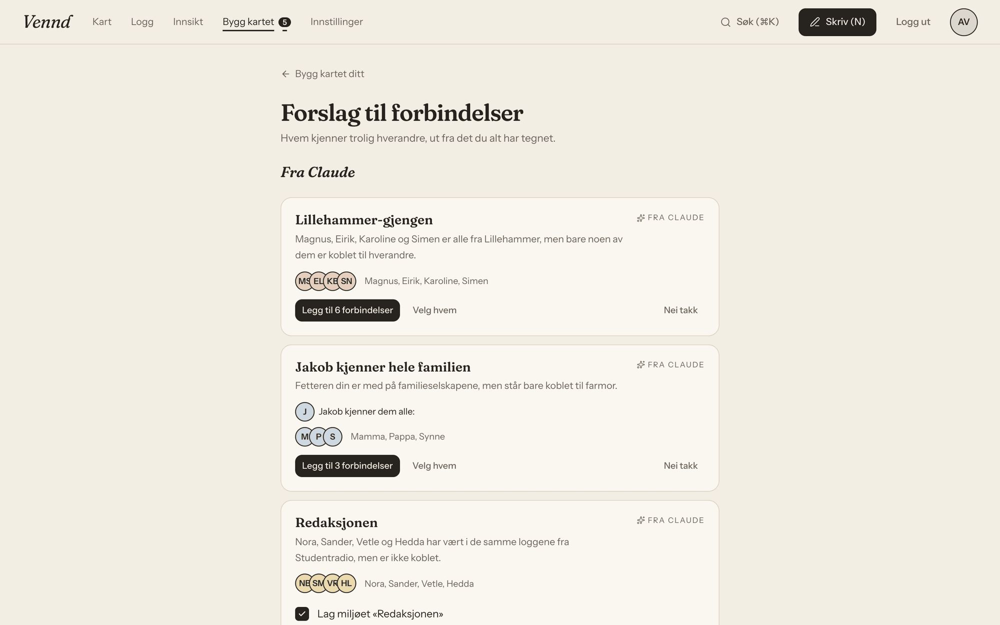
</picture>

Jeg har passet på hva det koster. Den første versjonen av forbindelser brukte
1,25 dollar på én økt, fordi den spurte Claude om hvert par. Nå er det ett kall,
maks én gang hvert femte minutt. Svarene sjekkes mot et zod-skjema, og
systemprompten caches.

## På mobil

Appen er laget for telefonen først og kan legges på hjemskjermen. På PC får du
sidepanel og hurtigtaster i stedet.

<picture>
  <source media="(prefers-color-scheme: dark)" srcset="docs/screenshots/dark/mobil.png">
  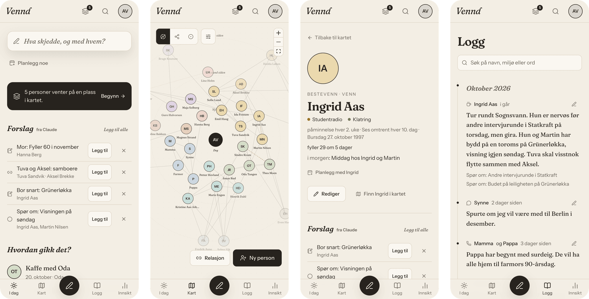
</picture>

## Teknisk

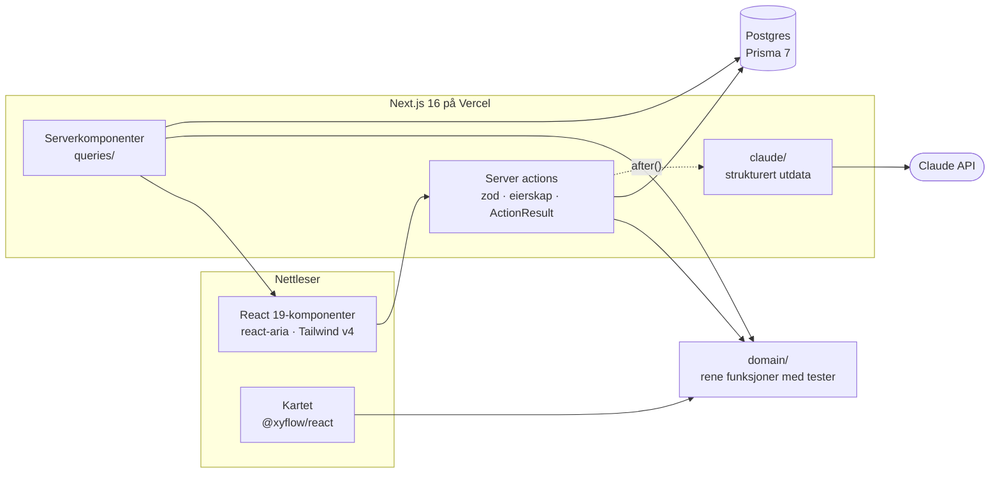

**Noen valg jeg har tatt:**

- **Logikken ligger for seg selv** i `src/domain/`, uten database eller React. Der
  ligger blant annet utregning av hvor lenge siden du så noen, kartplasseringene,
  søk, navnegjenkjenning, duplikater og import av `.vcf` og `.ics`. Det gjør det
  enkelt å teste, og det er der de fleste testene er.
- **Alle server actions er skrevet likt.** De sjekker input med zod, sjekker at
  dataene tilhører brukeren og returnerer et `ActionResult`. På klientsiden går
  alle kall gjennom `settle()`, så feil vises på samme måte overalt.
- **Datoer.** En dato lagres kl. 12 UTC, og «i går» eller «om 5 dager» regnes ut
  i nettleseren. Da hopper ikke datoer en dag, og server og nettleser er enige.
- **Kartet er forutsigbart.** Samme data gir samme kart. «Rydd opp» kan angres.
- **All tekst ligger i én fil** (`src/i18n/nb.ts`), så det er enkelt å legge til
  flere språk senere.
- **Drift.** Databasen migreres automatisk når det bygges for produksjon, og
  antall databasetilkoblinger er begrenset, så Prisma Postgres ikke går tom.

Prosjektet har rundt 23 000 linjer TypeScript, 373 tester (Vitest og Testing
Library), 13 migreringer og over 40 PR-er. Hver funksjon startet som en
spesifikasjon i [`docs/superpowers/specs/`](docs/superpowers/specs/), og hver PR er
sjekket i nettleseren på mobil og PC, i lys og mørk modus, og med axe for
tilgjengelighet.

## Kom i gang

```bash
npm install
cp .env.example .env.local   # fyll inn database- og Google-OAuth-verdier
npx prisma migrate deploy
npm run dev
```

### Utvikling uten å røre prod

```bash
npx prisma dev -n vennd --detach        # lokal Postgres (skriver ut tilkoblingen)
# Lag en egen database (ikke bruk template1) og sett DATABASE_URL i .env.local
npx prisma migrate deploy
npx prisma db seed                       # realistiske data for dev-brukeren
node --env-file=.env.local scripts/dev-session.mts
```

Det siste skriptet skriver ut en sesjonscookie for dev-brukeren. Sett den som
`authjs.session-token` på localhost, så er du logget inn uten Google. Seed-skriptene
nekter å kjøre mot noe annet enn localhost.

Utstillingsdataene fra bildene lages med
`node --env-file=.env.local scripts/seed-showcase.mts`.

| Kommando | Hva den gjør |
| --- | --- |
| `npm run dev` | Dev-server på http://localhost:3000 |
| `npm run build` | `prisma generate`, migrering (bare i prod) og produksjonsbygg |
| `npm run lint` | ESLint |
| `npm test` | Vitest (én gjennomkjøring) |

### Struktur

```
src/app/           sider (serverkomponenter), parallelle ruter for sidepanelet
src/server/        queries/ (lesing), actions/ (skriving), claude/ (AI), alltid scopet på bruker
src/domain/        ren logikk uten database: ferskhet, layouter, søk, innsikt, import
src/components/    ui/ (primitiver), graph/ (kartet), composer/, person/, sort/ …
src/i18n/          all synlig tekst
prisma/            skjema, migreringer og seed
docs/              spesifikasjoner, planer og skjermbilder
```
